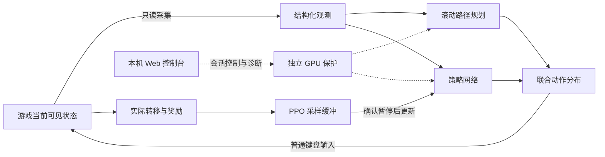

# TH06NC-Neural-Pilot

[](LICENSE)
[](docs/development.md)
[](pyproject.toml)
[](docs/core-logic.md)
[](native/README.md)
[](#使用前需要知道)

**探索如何让 AI 在弹幕中生存、收集资源，并有效地推进关卡。**

[快速开始](#快速开始) · [工作原理](#工作原理) · [常见问题](docs/faq.md) · [项目文档](#项目文档) · [路线图](#路线图) · [参与贡献](#参与贡献)

TH06NC-Neural-Pilot 是面向 Windows Steam 版《东方红魔乡：新典》的用于个人学习的游戏 AI 项目。它将 **PPO 强化学习**与**滚动路径规划**结合，通过只读游戏状态理解当前场景，使用普通键盘输入操作自机，并提供一个本机 Web 控制台来管理训练、模型和诊断。

项目由 xialongxl 维护，主要借助 AI 辅助开发。代码采用 [MIT License](LICENSE)。

## 为什么做这个项目

这个项目的起点很简单：**想做一个能通过训练，逐步学会玩《东方红魔乡：新典》的 AI。** 具体来说，就是子弹来了会躲，安全时会捡 P 点提升火力，打 Boss 时能一边躲弹一边保持攻击。

为了实现这个目标，神经网络从一局局实际游戏中学习怎样行动，路径规划则帮助它判断接下来往哪里走更安全。项目也提供训练、暂停、模型保存和失败记录，方便观察它学到了什么、在哪里反复出错，再继续改进。

长期目标是让 AI 稳定通关，并进一步挑战 **NMNB**（No Miss No Bomb）。当前仍处于实验阶段，尚未验证能稳定完整通关。

## 现在可以做什么

| 能力 | 实现方式 |
| --- | --- |
| 感知当前场景 | 读取自机、普通弹、道具、敌机本体和本版直线激光，识别关卡与菜单／对话状态 |
| 选择训练场景 | 在控制台选择难度、灵梦／魔理沙 A/B，以及 Practice 起始关卡；显示真实读数 |
| 学习移动与资源取舍 | PPO 使用实际游戏采样更新策略；观测包含火力、B、残机、道具及历史控制信息 |
| 评估躲避路线 | 滚动搜索比较当前 18 种方向／快慢速选择及后续转向，考虑弹幕、本体、激光和控制延迟 |
| 管理训练与模型 | Web 控制台支持新建、续训、暂停／恢复、保存结束、历史检查点选择、试玩和独立评估 |
| 分开训练目标 | 生存练习允许学习保命 B；NMNB 模式屏蔽炸弹动作 |
| 保留诊断证据 | 动作时序、奖励分项、资源变化、阶段日志、PPO 观测及死亡前原始快照 |
| 加速实时计算 | 可选 Rust/PyO3 碰撞与整段搜索，CUDA Graph 推理及复用缓冲 |
| 独立保护 | GPU 监控与训练进程分离，支持 F8 紧急终止所属进程树 |

移动由网络与当前几何规划共同形成的动作分布决定，随观测重新计算；菜单、对话、暂停和重开由外围状态机处理。训练、执行和 PPO 回算使用同一个动作及其概率。

### 使用前需要知道

本仓库提供**训练系统源码**，不附带预训练模型、游戏本体或作者的本机校准文件。首次使用需要安装依赖、构建界面、设置游戏路径并完成校准。

当前实际接入面向 **Windows x64、Python 3.10 和 NVIDIA/CUDA**。控制台支持选择难度、自机和 Practice 关卡；已有实机训练基线为 **Normal、灵梦 A**，新增设置不代表其他组合已经验证能通关。支持范围和解锁规则见[游戏设置与 Practice](docs/game-settings.md)。

<details>
<summary>已适配游戏版本与验证边界</summary>

- Steam build：`25306795`。
- 主程序 SHA-256：`48630a42a2eb6762d0db2a7e0d151203efbe67220fef7d2f9d0d51857928ac82`。
- 当前版本池容量：普通弹 640 槽、敌机 256 槽、直线激光 64 槽；网络另保留近场 64 弹分支。
- 未知游戏版本会拒绝接入；移植需要核对结构和代码特征，不能只替换哈希。
- 路径预测基于有限窗口与已观测运动，新生、转向、传送及未知攻击可能使预测失效。
- 离线测试、组件耗时和只读实机测量分别记录，不能当作稳定通关或整条控制链低于 2ms 的证明。

详细证据和测量范围见[测试与性能](docs/testing-and-performance.md)。

</details>

## 快速开始

### 1. 准备环境并获取源码

准备 Windows 10/11 x64、已适配的游戏、支持本项目 CUDA wheel 的 NVIDIA 驱动、Python 3.10 和 `uv`。首次构建界面还需要 Node.js/npm，构建脚本要求 Node.js 22.12+ 或 24 LTS。Rust 是可选加速依赖。

```powershell
git clone https://github.com/xialongxl/TH06NC-Neural-Pilot.git
cd TH06NC-Neural-Pilot
```

### 2. 安装 Python 依赖并设置游戏路径

```powershell
powershell -ExecutionPolicy Bypass -File .\install.ps1
notepad .\config.json
```

安装脚本会建立项目自己的 `.venv`，获取并校验官方 CUDA wheel；第一次下载体积较大。没有配置时，它会从 `config.example.json` 创建 `config.json`，已有配置则保留。

将 `game_exe` 设置为自己电脑上 **`th06nc.exe` 的完整路径**。本机配置被 Git 忽略，其他人的目录不会成为你的运行前提。项目使用 `config.json` 配置，不会自动加载 `.env`。

### 3. 构建并打开控制台

```powershell
powershell -ExecutionPolicy Bypass -File .\build-ui.ps1
.\启动AI.cmd
```

浏览器默认打开[http://127.0.0.1:18765](http://127.0.0.1:18765)，可以看到训练控制台、模型库、保护与诊断页面。打开控制台本身不会开始训练。界面构建完成后，日常运行不需要常驻 Vite 或 Node.js 服务。

如果只想先查看界面，可以使用只读预览：

```powershell
.\.venv\Scripts\python.exe -m th06ai open --preview
```

预览默认使用端口 `18766`，不接入实际游戏或 GPU，也不启动训练。

### 4. 完成接入，再开始第一次训练

在“保护与诊断”完成 GPU 自检，打开游戏并按指南完成移动、低速、弹幕与重开校准，然后核对游戏显示的 Power、B 和残机。

**首次资源确认目前需要人工辅助，自动校准不会替你完成这一步。** 具体操作见[首次校准与资源核对](docs/development.md#首次校准与资源核对)。

没有模型时选择“新建模型”；已有本项目兼容检查点时，在模型库选择后续训或试玩。首次建议使用短会话，观察输入、资源、攻击和暂停行为，再决定训练时长。训练时保持英文输入法、游戏前台，避免同时手动操作游戏。

启动前在“游戏设置”选择完整流程或 Practice、难度与自机。Practice 可以指定已解锁关卡，完整流程从首关开始，Extra 使用游戏独立入口；选择在下次会话生效，运行中的设置以实际读取为准。

需要原生加速时，按 [Rust 构建说明](native/README.md)安装扩展。其他配置、开发模式和命令行用法见[开发者指南](docs/development.md)。

### 第一次运行遇到问题

| 现象或疑问 | 先看这里 |
| --- | --- |
| 校准完成，却仍提示需要确认资源 | [首次接入的三项检查](docs/faq.md#首次运行为什么还不能开始训练) |
| 模型库为空，不知道从哪里开始 | [预训练模型与第一次训练](docs/faq.md#有现成模型吗多久能学会) |
| 想确认暂停、续训和关闭网页的区别 | [会话与检查点](docs/faq.md#暂停恢复和续训有什么区别) |
| 不确定 Rust、CUDA 和 CPU 分别做什么 | [计算设备与原生加速](docs/faq.md#为什么用了-gpu-仍有-cpu-占用rust-必须安装吗) |
| 游戏更新后无法接入，或模型不兼容 | [版本与升级](docs/faq.md#更新游戏或项目后需要注意什么) |

## 训练时怎么操作

游戏移动使用**方向键**，Shift 低速、Z 射击、X 炸弹；正常动作持续射击。菜单确认使用 Z，暂停使用 Esc，本版重开由外围流程处理。

| 操作 | 会发生什么 |
| --- | --- |
| **F7 / 暂停训练** | 暂停当前进程和回合，保留模型、优化器及部分采样缓冲 |
| **F7 / 恢复本次训练** | 继续同一会话；直接按 F7，无需组合 Shift |
| **从检查点续训** | 创建新会话和新回合，保留已保存权重、兼容优化器状态和累计步数 |
| **保存并结束** | 在安全边界暂停游戏，保存已更新模型并结束训练 |
| **F8 / 紧急停止** | 立即终止本项目计算进程树并释放按键，不等待模型保存 |
| **关闭或刷新网页** | 后台会话继续存在；重新打开后可查看现有状态 |
| **关闭服务 / 关闭AI.cmd** | 请求训练保存结束，等待所属会话退出后关闭后端 |

检查点保存的是学习进度，不包含游戏内存和未完成的采样批次。暂停恢复与从磁盘续训因此有不同语义；紧急停止后从最近一次成功保存处继续。

独立保护默认每 250ms 采样，核心温度达到 70°C、显存达到 90% 或检测到对应硬件异常时停止；遥测连续 60 秒未更新也会停止。具体阈值和传感器边界见[开发者指南](docs/development.md)。软件监控只能响应可观察的信息，不能保证发现所有物理故障。

## 工作原理



**学习**处理可逐步改善的策略，**规划**评估当前移动的短时几何后果。规划同时考虑旧按键在计算期间继续生效的时间；资源和攻击评分参与可行路线之间的选择。

**保护与显示分开运行。** 浏览器通过 REST 和增量 SSE 管理会话、显示状态，实时决策不经过页面。游戏只读采集、模拟输入、CUDA/PPO 和独立保护各有明确边界。

当前没有数据库，状态、轨迹与检查点保存在本地文件。普通训练不依赖 Computer Use，也不读取未来出弹计划。

### 技术栈与代码入口

| 部分 | 实现 | 入口 |
| --- | --- | --- |
| 控制台 | React、TypeScript、Vite | [frontend/](frontend/README.md) |
| 本机服务 | FastAPI、REST、增量 SSE | [web_console.py](th06ai/web_console.py) |
| 游戏接入 | 版本固定的只读状态与 Windows 输入 | [native.py](th06ai/native.py)、[environment.py](th06ai/environment.py) |
| 在线决策 | 滚动搜索、集合编码器、联合策略 | [planning.py](th06ai/planning.py)、[policy.py](th06ai/policy.py) |
| 学习与模型 | PyTorch、Stable-Baselines3、Gymnasium | [learning.py](th06ai/learning.py) |
| 原生加速 | Rust、PyO3 | [native/](native/README.md) |
| 独立保护 | NVML、共享授权、Windows Job Object | [supervisor.py](th06ai/supervisor.py) |

完整目录、模块关系和阅读顺序见[代码地图](docs/code-map.md)。依赖版本由安装脚本及各锁文件记录。

## 项目文档

| 你要做什么 | 建议阅读 |
| --- | --- |
| 本地运行、配置或构建 | [开发者指南](docs/development.md) |
| 选择难度、自机、Practice 与关卡 | [游戏设置与 Practice](docs/game-settings.md) |
| 首次接入、训练目标或日常操作有疑问 | [常见问题](docs/faq.md) |
| 理解进程和数据流 | [架构说明](docs/architecture.md) |
| 查找某项功能的实现 | [代码地图](docs/code-map.md)、[机器可读符号索引](docs/code-index.json) |
| 深入感知、决策、学习与保护 | [核心逻辑拆解](docs/core-logic.md) |
| 修改观测、动作、模型或日志格式 | [数据契约](docs/data-contracts.md) |
| 排查边界问题或准备重构 | [易错点与边界条件](docs/gotchas.md) |
| 验证行为与性能 | [测试与性能](docs/testing-and-performance.md) |
| 配置轨迹、保存与控制链诊断 | [性能与诊断配置](docs/performance-tuning.md) |
| 交给另一个 AI 接手 | [AI 交接信](docs/ai-handoff.md)、[结构化上下文](docs/ai-context.json)、[AGENTS.md](AGENTS.md) |
| 了解 Git 过滤和发布流程 | [开源准备](docs/open-source-readiness.md) |

## 路线图

接下来的工作重点是让训练更容易复现，也让行为变化更容易验证：

- [ ] 完善新机器的资源确认与首次接入引导。
- [ ] 扩充特殊攻击、激光类型与其他游戏设置的验证。
- [ ] 建立更统一的固定权重评估流程，逐步验证完整通关与 NMNB。
- [ ] 持续分析完整控制链的慢尾，提供更多可公开复核的场景和基准。
- [ ] 完善 Python 依赖锁定、自动化 CI 与跨机器构建验收。
- [ ] 补充不含个人数据的控制台截图与首次操作录像。

已有的训练、规划和保护能力会继续维护；路线图按实际问题与贡献调整，不承诺某个训练时长一定达到通关表现。

## 参与贡献

欢迎提交可复现的问题、脱敏的几何反例、独立评估记录、代码和文档改进。

- 遇到问题：在 [Issues](https://github.com/xialongxl/TH06NC-Neural-Pilot/issues) 描述环境、步骤、预期与实际结果。
- 准备修改：先看 [CONTRIBUTING.md](CONTRIBUTING.md)，按变更领域选择测试，再提交 [Pull Request](https://github.com/xialongxl/TH06NC-Neural-Pilot/pulls)。
- 使用 AI 辅助开发：同时阅读 [AGENTS.md](AGENTS.md)，保留实测证据和模型兼容性，明确哪些内容尚未验证。

提交前可以运行：

```powershell
.\.venv\Scripts\python.exe tools\check_docs.py
.\.venv\Scripts\python.exe tools\check_source.py
```

后者核对 Git 实际候选文件，帮助把个人配置、缓存、日志和模型留在本机。不要上传游戏文件或未经脱敏的完整训练目录。

## 作者与许可

作者：[xialongxl](https://github.com/xialongxl)。这是个人维护的非官方研究项目。

代码采用 [MIT License](LICENSE)。项目倡导强化学习交流与非商业单机游戏探索，这一用途倡议不构成 MIT 的附加限制。原作游戏及第三方内容的权利独立适用，相关使用须遵守对应规则；具体说明见[免责声明](DISCLAIMER.md)。

## 致谢

首先感谢 **ZUN**，以及他主宰的 **上海アリス幻樂団（Team Shanghai Alice）**，创作了东方 Project 和《东方红魔乡》。这个项目对弹幕、关卡推进与学习过程的探索，建立在原作的游戏设计之上。原作署名可查阅[东方 Project 官方介绍](https://touhou-project.news/touhou_project/)。

也感谢《东方红魔乡：新典》的开发与发行团队：

- **上海アリス幻樂団、上海アリスReprise（官方中文名：上海爱丽丝幻回奏）**：《新典》的开发署名；新社团的官方网站列有 **ZUN、JYUNYA** 等成员，《新典》的背景音乐由 ZUN 重新编曲。见[《新典》官方网站](https://touhou-project.news/shanghai-alice-reprise/cn/)。
- **Alliance Arts**：《新典》的发行方。开发与发行署名见 [Steam 官方商店页](https://store.steampowered.com/app/4659620/)。

上述致谢用于明确创作者与作品来源，不代表本项目获得官方授权、合作或背书。游戏及相关素材的权利以官方声明为准。

感谢 **PyTorch、Stable-Baselines3、Gymnasium、NumPy、React、FastAPI、PyO3** 等开源项目，为模型训练、环境接口、数值计算、控制台和原生扩展提供基础。

本项目使用和参考的第三方代码及许可记录在 [THIRD_PARTY_NOTICES.md](THIRD_PARTY_NOTICES.md)。也感谢每一份帮助复现问题、检验假设和改善实现的贡献。
