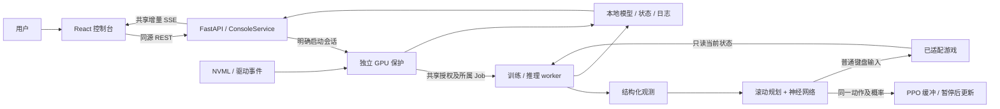

# TH06NC-Neural-Pilot

[GitHub 仓库](https://github.com/xialongxl/TH06NC-Neural-Pilot) · [Issues](https://github.com/xialongxl/TH06NC-Neural-Pilot/issues) · [Pull Requests](https://github.com/xialongxl/TH06NC-Neural-Pilot/pulls)

**面向 Windows Steam 版《东方红魔乡：新典》的实验性游戏 AI：用 PPO 学习策略，用滚动路径规划评估移动，通过本机网页控制训练。**

这是一个个人项目，主要借助 AI 辅助开发。文档面向希望运行、研究、贡献代码的人类开发者，以及未来接手维护的 AI 助手。源码核对基准为 **2026-11-02**。

作者：**夏龙xl（xialongxl）**。代码采用 [MIT License](LICENSE)。本项目倡导强化学习技术交流与非商业单机游戏探索；该倡议不构成 MIT 的额外许可限制。游戏与第三方素材权利不属于本项目 MIT 授权，使用前阅读[免责声明](DISCLAIMER.md)及[第三方来源](THIRD_PARTY_NOTICES.md)。不分发游戏本体。

## 项目解决什么问题

弹幕游戏的学习需要可靠观测、真实动作时序、合理奖励、可恢复训练和可追溯诊断。本项目将这些环节连成可检查的系统：

- **学习与规划结合**：网络输出和当前路径评价合成同一个真实动作分布，PPO 使用的概率与执行动作一致。
- **读取可见状态**：只读适配版本游戏的自机、普通弹、资源、敌机和直线激光；速度由连续观测估计，不读取未来出弹计划。
- **完整当前移动选择**：比较 18 种方向／快慢速组合，加入炸弹后共 36 类动作；持续射击。方向键移动、Shift 低速、Z 射击、X 炸弹。
- **可控训练**：新建、续训、暂停／恢复、保存结束、历史模型选择、固定权重试玩和独立评估。
- **独立显卡保护**：保护进程与 CUDA/PPO 工作进程分离，F8 可终止所属进程树；暂停时监控继续运行。
- **可追溯诊断**：记录关卡、资源、奖励分项、动作时序、原始死亡快照、PPO 观测和评估进度；Rust/PyO3 可加速碰撞与整段搜索。
- **前后端分离**：React 显示状态并提交控制请求；训练、游戏输入和硬件保护由后端进程承担。

它不是固定路线宏，也不是通过语言提示词即时操作游戏。奖励和结构化观测表达目标，网络参数通过真实采样学习；菜单、暂停、对话和重开由外围状态机处理。

## 支持范围与状态

| 项目 | 当前情况 |
| --- | --- |
| 实机平台 | Windows 10/11 x64；验证环境为 Python 3.10、NVIDIA/CUDA |
| 游戏 | Steam《东方红魔乡：新典》，build `25306795` |
| 主程序 SHA-256 | `48630a42a2eb6762d0db2a7e0d151203efbe67220fef7d2f9d0d51857928ac82` |
| 训练设置基线 | Normal、灵梦 A；其他设置需重新核对 |
| 格式版本 | 观测 v8、奖励 v8、策略 v2、规划 v7、动作计时 v3 |
| 已适配池容量 | 普通弹 640、直线激光 64、敌机 256；另保留最近 64 枚普通弹的近场编码 |
| 持久化 | JSON、JSONL、CSV、NPZ、SB3 ZIP 检查点；没有数据库 |
| 稳定通关 | **尚未证明稳定通关或完整 NMNB 通关**；测试通过不等同于实机通关 |
| 首次运行 | GPU 自检、移动／重开校准、人工资源读数核对 |
| 模型及校准凭据 | 默认不随源码分发；本机存在模型不代表公开提供下载模型 |

未知游戏版本会被拒绝接入。不能只改 SHA-256 绕过检查：地址、代码特征、池结构和场景语义必须一起适配。

## 文档导航

| 目的 | 文档 |
| --- | --- |
| 理解进程、数据流和边界 | [架构说明](docs/architecture.md) |
| 找到功能对应源码 | [完整代码地图](docs/code-map.md)、[符号索引](docs/code-index.json) |
| 理解五条核心执行链 | [核心逻辑拆解](docs/core-logic.md) |
| 核对观测、动作、模型和日志格式 | [数据契约](docs/data-contracts.md) |
| 安装、配置、调试、构建与部署 | [开发者指南](docs/development.md) |
| 查故障与重构边界 | [易错点与边界条件](docs/gotchas.md) |
| 跑测试、正确理解延迟数字 | [测试与性能](docs/testing-and-performance.md) |
| 让其他 AI 接手 | [AI 交接信](docs/ai-handoff.md)、[结构化上下文](docs/ai-context.json)、[AGENTS.md](AGENTS.md) |
| 准备公开仓库及发布包 | [开源准备](docs/open-source-readiness.md)、[第三方来源](THIRD_PARTY_NOTICES.md) |
| 提交 Issue 或 PR | [贡献指南](CONTRIBUTING.md) |

## 技术栈

以下表示仓库或安装脚本采用的版本，不表示所有更高版本均已验证。

| 层 | 技术 |
| --- | --- |
| 前端 | React / React DOM `19.3.1`、TypeScript `7.0.2`、Vite `8.3.5`、Lucide React `1.66.0` |
| 前端测试 | Vitest `5.0.5`，使用 `frontend/package-lock.json` |
| 本机 API | Python、FastAPI `0.162.0`、Uvicorn `0.54.0`、Pydantic |
| UI 通信 | 同源 REST + 增量 SSE/JSON；可见页最多 2Hz，隐藏页降低频率 |
| 学习 | PyTorch `2.14.1+cu130`、Stable-Baselines3 `2.9.2`、Gymnasium `1.4.0`、NumPy `2.2.6` |
| 系统 | Windows 只读进程 API、普通 SendInput、Job Object、共享内存、全局快捷键 |
| 硬件保护 | NVIDIA NVML、Windows 驱动事件；不调整显卡运行参数 |
| 可选加速 | Rust、PyO3 `0.30.1`，原碰撞／按键扩展及独立整段搜索扩展 |

[pyproject.toml](pyproject.toml) 是包依赖声明；[install.ps1](install.ps1) 固定本机已验证安装版本，并获取官方 CUDA wheel。两者不是同一套完整依赖锁文件。

## 快速开始

这是**新检出源码**的流程，不假设其他机器拥有作者的环境、模型、前端产物或校准文件。

1. 准备 Windows x64、已适配的游戏、支持该 CUDA wheel 的 NVIDIA 驱动、Python 3.10 和 `uv`。重建前端还需 Node.js/npm；构建脚本提示 Node.js 22.12+ 或 24 LTS。
2. 在项目根目录安装依赖并创建本机配置。初次下载 CUDA wheel 体积较大，脚本校验官方索引中的 SHA-256。

   ```powershell
   powershell -ExecutionPolicy Bypass -File .\install.ps1
   Copy-Item -LiteralPath .\config.example.json -Destination .\config.json
   notepad .\config.json
   ```

   将 `game_exe` 改为本机 `th06nc.exe` 的完整路径。已有配置时保留原文件，不要覆盖。

3. 构建前端：

   ```powershell
   powershell -ExecutionPolicy Bypass -File .\build-ui.ps1
   ```

4. 双击 [启动AI.cmd](启动AI.cmd)，或运行：

   ```powershell
   .\.venv\Scripts\python.exe -m th06ai open
   ```

   默认 `http://127.0.0.1:18765`。它启动本机服务并打开网页，**不会自动训练**。`启动后端.cmd` 是兼容入口。运行已构建 UI 不需要 Node.js 服务。

5. 在“保护与诊断”自检 GPU，打开游戏，完成[首次校准与资源核对](docs/development.md#首次校准与资源核对)。资源确认目前需要人工辅助，不要复制其他人的 `operator_confirmed=true` 凭据。
6. 无模型时选“新建模型”；有本项目兼容检查点时在模型库选中续训／试玩。先短时验收，再安排长训练；保持英文输入法和游戏前台，避免同时手动操作。

可选 Rust 构建见 [native/README.md](native/README.md)。缺少扩展时有 Python 路径，但性能不能视作相同。

### 暂停、结束与退出

| 操作 | 语义 |
| --- | --- |
| F7／暂停训练 | 暂停同一进程和回合，保留模型、优化器及部分缓冲 |
| F7／恢复本次训练 | 恢复同一会话；不要求组合 Shift，Shift 仅为低速键 |
| 从检查点继续训练 | 新会话、新游戏回合；保留已保存权重、兼容优化器和累计步数 |
| 保存并结束 | 等待安全边界、暂停游戏并保存已更新模型 |
| F8／紧急停止 | 终止本项目进程树、释放按键，不等待 CUDA 保存 |
| 关闭／刷新网页 | 后台会话继续存在，重新打开后连接现有状态 |
| 关闭服务／[关闭AI.cmd](关闭AI.cmd) | 先请求训练保存结束，所属会话退出后关闭服务 |

磁盘检查点不保存游戏内存或尚未更新的采样批次。紧急停止后从最近成功保存处继续。

## 核心目录

```text
th06nc/
├─ th06ai/                 API、会话、保护、读取、规划、策略与训练
│  ├─ __main__.py          CLI；普通入口不绕过保护直接启动 worker
│  ├─ web_console.py       回环 HTTP API、控制令牌、静态前端
│  ├─ console_service.py   与 UI 无关的模型选择和会话控制
│  ├─ supervisor.py        独立 GPU 保护、所属 Job 生命周期
│  ├─ worker.py            授权下的校准／训练／推理
│  ├─ native.py            固定版本的只读状态适配
│  ├─ environment.py       Gym 环境、输入、场景状态机、采样边界
│  ├─ observations.py      观测 v8
│  ├─ planning.py          滚动规划、参考实现和 Rust 调用
│  ├─ policy.py            集合编码器、联合分布、炸弹分支
│  ├─ learning.py          PPO 创建／加载／保存／评估及回调
│  └─ native_planner/      独立搜索扩展安装位置
├─ frontend/src/           React、SSE 归并、类型、前端测试
├─ native/src/             Rust/PyO3 碰撞、输入、整段搜索
├─ tests/                  离线回归、故障注入、CPU PPO、真实几何夹具
├─ tools/                  下载、构建、文档核验
├─ docs/                   项目说明书
├─ config.example.json     可复制的无本机信息配置
├─ .env.example            可选环境示例；没有自动 dotenv 加载
├─ models/                 本机检查点及历史，不随源码分发
├─ runs/                   本机日志、快照、状态、评估，不随源码分发
└─ .cache/                 下载／编译／测试缓存，不是训练数据集
```

[代码地图](docs/code-map.md)解释每个运行时模块。`research/` 默认不进入公开源码包；其可公开的性能结论整理于[测试与性能](docs/testing-and-performance.md)。

## 数据如何流动



实时动作不经过浏览器。UI 不接收完整弹幕逐帧流，也不持有 CUDA 模型、游戏写句柄或关键保护授权。

## 开发与贡献

按改动范围选择验证，完整入口如下：

```powershell
# 文档检查，不导入游戏或 GPU
.\.venv\Scripts\python.exe tools\check_docs.py

# Windows 离线后端回归，不等于实机验收
.\.venv\Scripts\python.exe -m pytest -q --basetemp .cache\pytest-doc-example

# 以下在 frontend 目录运行
npm.cmd test
npm.cmd run build
```

贡献前阅读[易错点](docs/gotchas.md)和[AI 交接信](docs/ai-handoff.md)。改观测布局、动作分布、暂停／跨关、共享授权或原生 ABI，需同步核对契约和测试，不能只看“能启动”。

2026-11-02 的本机优化验证包括完整 Python 回归 446 项、Rust 单元测试 4 项。这是验证基线，不是所有环境的保证；没有游戏、硬件、校准的源码检出不能伪造相同实机结果。

## 已知限制及发布前待办

- 只适配一个明确游戏 build，尚无多版本适配层。
- 快照读取与游戏并行，不保证严格同帧；空弹幕、冻结计时和未知场景有不同语义。
- 短时匀速预测不保证躲过未来新生、转向、传送或未适配攻击，不能称作最优路径或绝对安全。
- 前端及原生扩展需要构建；没有验证过的单文件 EXE、完整 wheel 资源打包、Docker 或远程部署方案。
- Python 尚无完整传递依赖锁；首次资源确认的自助流程、跨机器验收及 CI 仍需完善。
- 作者已选择标准 MIT；原作及第三方权利仍独立适用。推送前核对 Git 提交内容，个人配置、缓存、日志和模型保留在本机。

参见[开源准备](docs/open-source-readiness.md)。
