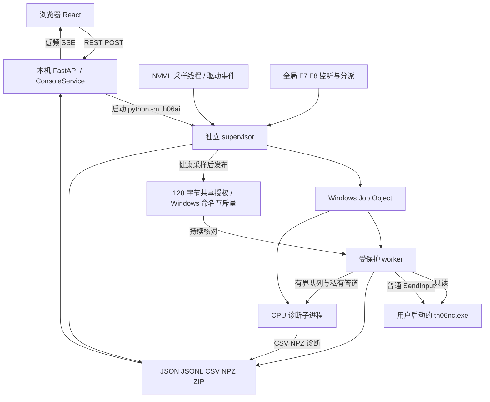
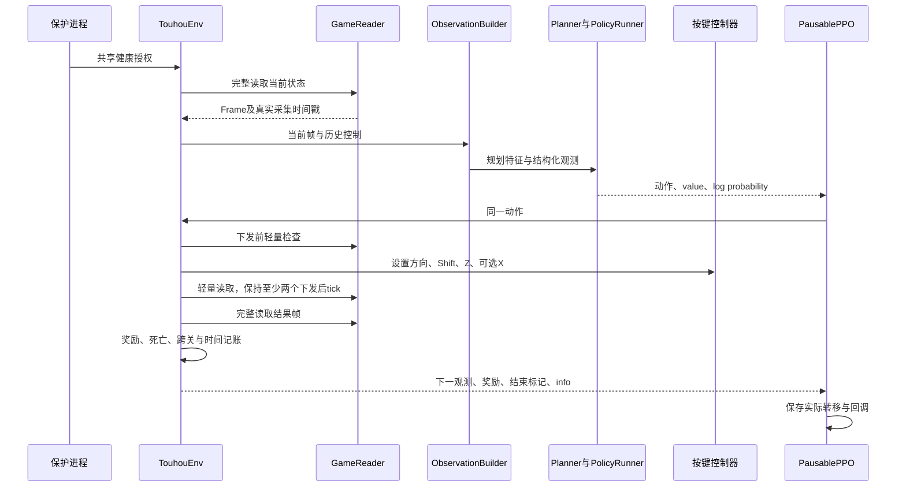
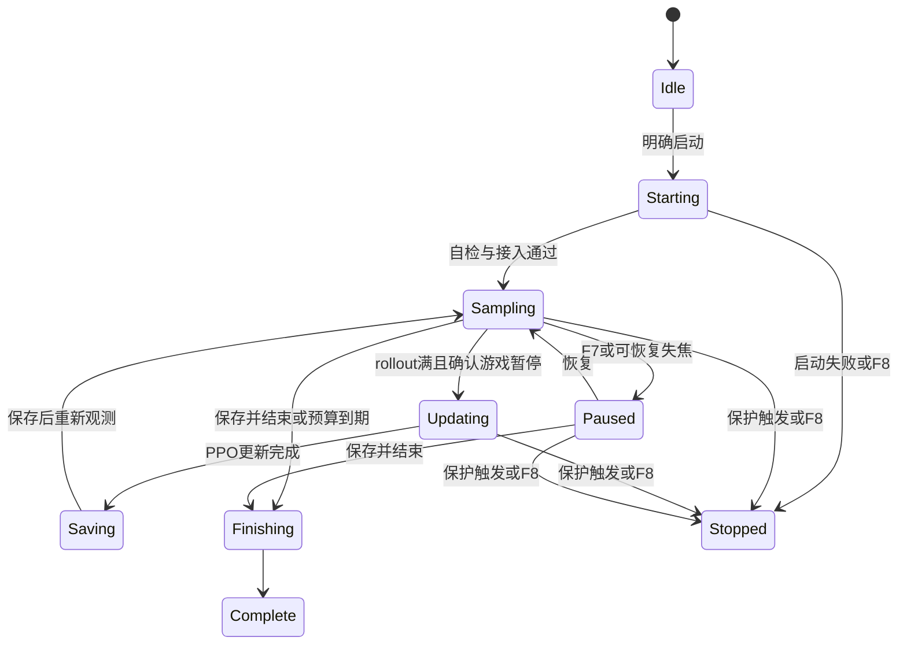

# 架构与执行边界

[English](en/architecture.md) · 简体中文

本文依据仓库源码，而不是预期功能。入口见[README](../README.zh-CN.md)，字段契约见[data-contracts.md](data-contracts.md)。

## 1. 四条链路

理解项目时先分清四条链路，避免把网页刷新率当成游戏控制频率。

| 链路 | 入口与终点 | 主要职责 | 不承担什么 |
| --- | --- | --- | --- |
| 用户控制 | 浏览器 → REST → ConsoleService → 会话标记／保护进程 | 启动、暂停、选择模型、结束 | 不逐帧控制方向 |
| 实时决策 | GameReader → ObservationBuilder → Planner + Policy → 输入 → 新观测 | 感知、规划、采样动作、执行、反馈 | 不经过 SSE／浏览器 |
| 学习 | 已发生转移 → rollout → 暂停游戏 → PPO 更新 → 检查点 → 恢复 | 更新参数及保存学习进度 | 不在正常运行中的游戏里长时间更新参数 |
| 保护与诊断 | NVML／驱动事件 → 独立保护；worker → 本地日志 → API → SSE | 停机、审计、界面显示 | UI 状态文件不是关键授权载体 |

没有数据库，也没有一个中央服务器同步多台客户端。当前部署单元是本机项目目录，加上用户自行启动的一个游戏进程。

## 2. 进程与线程



### 浏览器

- `frontend/src/useConsole.ts` 获取 bootstrap、订阅 SSE、提交带控制令牌的请求。
- `App.tsx` 展示训练、模型库、诊断；`stream.ts` 处理增量版本与曲线游标。
- `main.tsx` 的 benchmark 构建才接入 React Profiler。普通控制台没有这项采样。
- 页面销毁／订阅断开不构成暂停、停止或训练启动指令。

### 本机服务

`web_console.py` 创建 HTTP 应用，`ConsoleService` 管理会话意图、检查点索引、本机 UI 状态和日志读取。服务默认绑定 `127.0.0.1:18765`，静态文件来自 `frontend/dist`。

服务不加载训练网络或持有 CUDA 上下文，不运行高频规划。明确的“检测游戏状态”请求可短暂创建只读 `GameReader`；“切回游戏”可调用窗口激活逻辑。这些是按需操作，不能描述成 API 在任何情况下都不访问游戏。

### 独立保护进程

`__main__.py` 对训练等命令调用 `run_guard()`。它独立拥有：

1. 项目范围互斥锁，避免同时接管同一项目。
2. NVML/驱动事件采样与 `SafetyPolicy`。
3. 所属 `OwnedJob`，以及其工作进程树的终止能力。
4. 共享授权的唯一发布权。
5. F7/F8 监听、紧急停止及用户暂停预算核算。
6. `status.json`、`gpu.jsonl` 和最终 `result.json`。

默认路径先得到三次健康采样才启动 worker。worker 以挂起状态创建、加入 Job 后恢复；启动器派生的子进程也应留在所属进程树内。不能只杀一个表面 PID。

保护循环不依赖 Torch、NumPy 或 React。NVML 调用由 `AsyncTelemetry` 线程执行；驱动调用阻塞时，主循环仍能判断过期、处理 F8，而不是一起卡在驱动函数里。

### 工作进程

`worker.py` 先等授权，再导入 Torch 和建立环境。模式包括自检、校准、训练、试玩、评估及剖析。游戏接管模式通过 `TouhouEnv` 统一持有读取器、按键控制器、奖励状态和观测构建器。

worker 内部的心跳线程约每 200ms 写 `worker.json`。原始诊断经有界队列与私有管道交给独立 CPU 子进程；发送／结果线程只负责传输和状态。诊断进程不接入游戏或 CUDA，普通结束有有限排空时间，硬件急停由所属 Job 一起终止。`PolicyRunner` 使用锁串行复用推理缓冲；Rust 搜索使用每次调用独立的拥有型输入。

## 3. 启动与关闭

### 普通启动

```text
启动AI.cmd
  → python -m th06ai open
  → console_lifecycle.open_console
  → 核对回环服务身份／启动锁／迟到取消标记
  → 必要时启动 web --no-browser
  → 等健康端点就绪
  → 打开网页
```

`启动后端.cmd` 是兼容别名，不是另一个必须执行的启动步骤。直接 `web --no-browser` 适合前台开发终端，`open` 适合日常复用与就绪等待。

服务身份包含固定服务名、项目目录散列及 preview 标记。只按端口“有东西响应”不足以证明它是本项目；改端口或关服务时都要保留身份核对。

### 启动会话

`POST /api/sessions` 在锁下校验模式、时长、模型 ID 和当前会话状态，建立新运行目录并启动保护 CLI。训练／试玩等明确启动请求会立即尝试切回已打开游戏；worker 后续仍核对焦点和授权。GPU 或模型加载慢时，不必等初始化完才第一次激活窗口。

`resume` 是 API 模式，实际转换为 `train --model ...`。它创建新会话，与 F7 恢复不是同一件事。API 不接受 shell 命令或用户传来的任意模型绝对路径。

### 关闭服务

`关闭AI.cmd → shutdown_console → 健康身份核对 → bootstrap token → /api/server/shutdown`。服务设置关闭状态、取消迟到启动，并为活动训练请求 FINISH；监控等模式使用 STOP。服务等待所属进程退出，再关闭 HTTP/SSE。

网页关闭的默认等待上限为 45 秒。若会话未退出，保留后端并给出原因，不悄悄强杀未知程序。硬件故障或 F8 走独立紧急路径，不等待模型保存。

## 4. 一次动作发生了什么



旧按键在读取、规划和推理期间仍作用于游戏。因此规划必须模拟旧控制前缀，动作最小保持时间从下发后计时，不能拿此前的推理耗时抵扣。

## 5. 训练与会话状态



状态图是语义图，状态字符串并非都逐字相同。HTTP/UI 常见活动状态来自 `ACTIVE_STATES`；worker 的中文 `phase` 是显示信息，不能当作唯一的控制协议。

需要同时区分三类时间：本次会话的单调时钟预算、原生游戏 tick 驱动的生存／关卡时间、暂停／焦点等待时间。PPO 更新属于训练工作；不应声称所有额外操作均不占会话预算。原生计时重置也不意味着“整局重新开始”。

## 6. 文件与通信的权责

| 载体 | 写入者 | 读取者 | 作用 |
| --- | --- | --- | --- |
| 共享授权 | 保护进程 | worker | 当前健康 GPU 身份、采样时间、保护进程身份 |
| `status.json` | 保护进程 | API／诊断 | 会话状态及最近 worker/GPU 汇总 |
| `worker.json` | worker 心跳 | 保护进程／API | 活性及显示诊断，不替代 GPU 授权 |
| `PAUSE/FOCUS/FINISH/STOP` | 控制服务／快捷键 | worker／保护进程 | 明确控制意图 |
| 检查点与元数据 | 暂停后的学习保存逻辑 | 模型库／后续 worker | 已保存学习状态 |
| SSE v2 | 共享 SnapshotBroker | 浏览器 | 显示 DTO 的版本化增量 |

UI 每 500ms 的上限与 GPU 每 250ms 的采样无关，也不限制游戏控制频率。所有订阅隐藏时 UI 采样降到 5 秒，无订阅则停采 UI；硬件保护不跟着停。

## 7. 代码分层规则

- 轻量常量放 `planner_spec.py`、`policy_spec.py`、`navigation.py`，避免保护进程因显示版本号导入深度学习栈。
- 游戏版本映射在 `native.py/combat.py/lasers.py/stage.py/game_phase.py`，不能散落到前端判断。
- 数值几何与动作概率在 worker 中计算；前端不补算“安全方向”。
- 奖励描述实际结果，不发按键；规划给分布提供约束与偏置，不在执行阶段偷偷换动作。
- 生命周期、模型保存和安全授权相互配合，但不能互相替代：正常保存追求完整，硬件停机优先终止计算。

对应风险与改动测试见[易错点](gotchas.md)及[测试与性能](testing-and-performance.md)。
