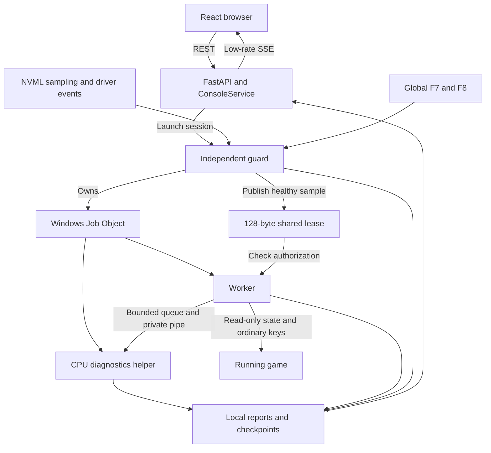
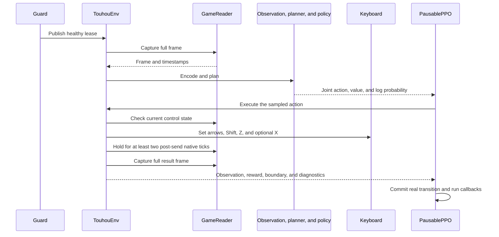

# Architecture and execution boundaries

English · [简体中文](../architecture.md)

TH06NC-Neural-Pilot runs on one Windows checkout with a locally installed game. Separate the operator controls, real-time action path, learning path, and independent protection when investigating a change.

| Path | Sequence | Responsibility |
| --- | --- | --- |
| Operator control | Browser → REST → `ConsoleService` → intent or guard | Explicit launch, model selection, pause, and finish |
| Real-time control | `GameReader` → observation → planner and policy → input → result frame | Observe, plan, sample, execute, and collect feedback |
| Learning | Transition → rollout → confirmed pause → PPO → save → fresh observation | Update and preserve learned state |
| Protection and reporting | NVML and hotkeys → guard, plus worker and guard → disk → SSE | Stop independently, record evidence, and display state |

## Processes

- **Browser.** `useConsole.ts` bootstraps the token and subscribes to SSE. `stream.ts` handles revisions and curve cursors. `App.tsx` presents the session, model library, and diagnostics. React profiling is restricted to the benchmark build. The browser closing or reconnecting carries no operator intent.
- **Local service.** `web_console.py` creates the app and serves the built console, normally at port `18765`. `ConsoleService` owns session intent, local UI state, model index, and log reads. Explicit probe and focus requests may inspect or activate the configured game. The service owns no live policy or CUDA context.
- **Guard.** `run_guard()` owns the project mutex, NVML telemetry, safety policy, F7/F8, a named-mutex-protected lease, and the Windows Job. The default startup waits for three healthy samples before starting the worker suspended, assigning it to the Job, and resuming it. `AsyncTelemetry` keeps blocked driver calls off the emergency-stop loop. The guard writes `status.json`, `gpu.jsonl`, and `result.json`.
- **Worker and diagnostics.** The worker waits for a lease before importing Torch. `TouhouEnv` owns game capture, input, reward state, and observation construction. A heartbeat thread writes `worker.json` about every 200 ms. A bounded queue and private pipe offload conversion and compression to a CPU-only diagnostics helper in the same Job. Normal exit drains within a finite deadline. Emergency stop applies to the owned tree. `PolicyRunner` serializes reusable buffers and Rust search owns its per-call snapshot.

## Lifecycle

`LaunchAI.exe` bundles the console lifecycle and resolves the checkout from the executable location. It checks service identity, coordinates through a start lock, and handles late cancellation. When a backend is needed, the launcher starts the project environment's `pythonw.exe` and waits for health before opening the browser. Service identity includes the service name, checkout hash, and preview flag. Launch failures appear in a dialog. Use `web --no-browser` for a foreground development terminal.

The session endpoint validates mode, minutes, checkpoint ID, setup, and current activity under a lock. It creates a run directory and invokes the guard CLI. Explicit live session launches can ask Windows to foreground the already-open game while initialization proceeds. The worker verifies focus and authorization independently. The `resume` endpoint starts a new training session with a checkpoint. F7 resumes the current in-memory session.

**Shut Down** in the web console and `.\LaunchAI.exe shutdown` use the same shutdown route. The launcher verifies service identity and obtains the bootstrap token first. Shutdown cancels late starts and asks active training to FINISH. Modes such as monitoring use STOP. It waits for the owned session before closing HTTP and SSE. The web flow defaults to a 45-second wait and reports a timeout if the backend remains. F8 takes the independent immediate path.

## One action

The previous keys remain active while the game advances during capture, planning, and inference. The planner models that prefix, and the minimum hold for the new action starts after dispatch. Pauses, dialogue, focus loss, and stage changes pass through the environment's session state machine.

A full rollout enters update only after a confirmed in-game pause. The worker updates PPO, saves completed learning, and resumes with a fresh observation. User pause, normal finish, and emergency stop each have separate semantics. Session time, native combat ticks, and paused or controlled waiting time have separate accounting. PPO updates count as training work.

## Sources of truth

| Carrier | Writer → reader | Purpose |
| --- | --- | --- |
| Shared lease | Guard → worker | GPU identity, healthy sample time, guard identity |
| `status.json` and `result.json` | Guard → API and diagnostics | Session state and final result |
| `worker.json` | Worker → guard and API | Heartbeat and reporting |
| `PAUSE`, `FOCUS`, `FINISH`, `STOP` | Controls → worker or guard | Explicit commands |
| Checkpoint and sidecar | Learning → catalog and subsequent worker | Verified saved learning state |
| SSE v2 | Snapshot broker → browser | Display state and deltas |

UI sampling tops out at one update every 500 ms. When all tabs are hidden it drops to five seconds, and with no subscribers display sampling stops. The default watchdog sampling period stays at 250 ms.

Keep lightweight constants separate from Torch imports, game layouts in the native reader and decoders, reward feedback separate from keyboard input, and action constraints inside the sampled distribution. [Core execution paths](core-logic.md) · [Data contracts](data-contracts.md) · [Verification](testing-and-performance.md)
